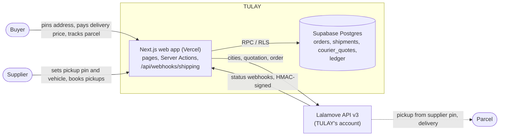
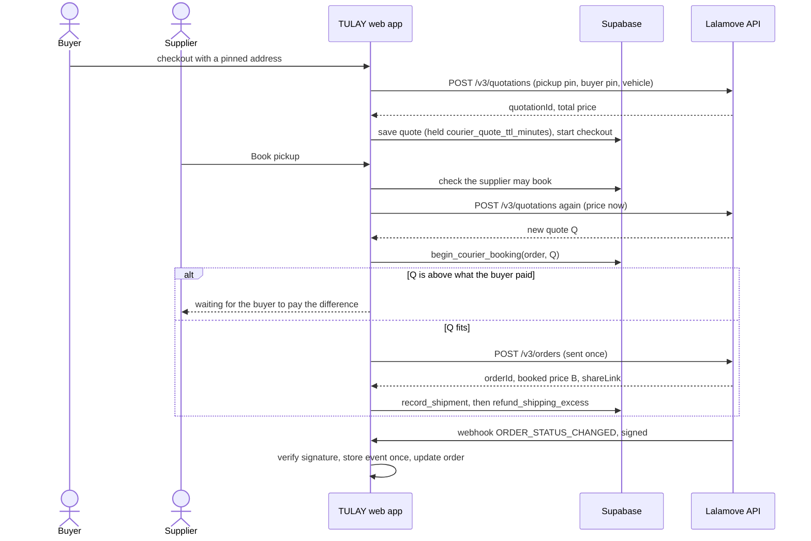

# TULAY × Lalamove: Courier Integration

TULAY books every courier parcel on ONE Lalamove account that TULAY owns (owner decision, 2026-11-27). Suppliers do not connect accounts. TULAY uses Lalamove API v3. Diagrams are Mermaid. Lalamove replaces Ninja Van as the active courier; the Ninja Van code stays, switched off (`COURIER_PROVIDER` picks one courier). Facts below come from the Lalamove docs (developers.lalamove.com) as read on 2026-11-27 and from the code in `lib/shipping/`. Anything the docs do not say is marked "not documented".

| Item | Value |
| --- | --- |
| What it is | Philippine B2B marketplace. Suppliers sell; buyers order; TULAY books the courier on its own Lalamove account. |
| Account | One TULAY Lalamove account. Suppliers keep a pickup pin (latitude and longitude on a map) and a default vehicle in their pickup settings. Buyers pin their delivery addresses the same way. |
| Own courier | A supplier may still ship on its own courier and type the tracking number in (manual shipment). TULAY does not book it and the ledger is not touched. |
| API base | `LALAMOVE_API_BASE` without `/v3`; paths include it. Sandbox `https://rest.sandbox.lalamove.com`, production `https://rest.lalamove.com`. HTTPS only. |
| Market | Header `Market: PH` (`LALAMOVE_MARKET`). |
| Request signing | `HMAC-SHA256(secret, "<ms>\r\n<METHOD>\r\n<path>\r\n\r\n<body>")`, lowercase hex. `<ms>` is the Unix time in milliseconds. GET and DELETE sign an empty body. Headers: `Authorization: hmac <key>:<ms>:<signature>`, `Market`, `Request-ID` (a fresh UUID, only a trace id for support), `Content-Type: application/json`. Allowed clock skew: not documented. |
| Endpoints used | `GET /v3/cities` (vehicle keys), `POST /v3/quotations` (price), `POST /v3/orders` (booking). |
| Checkout quote | At checkout TULAY asks Lalamove for a live price (pickup pin to buyer pin, supplier's default vehicle) and the buyer pays it. TULAY holds that price for the buyer for the admin setting `courier_quote_ttl_minutes` (default 15). Lalamove itself honours a quotation for 5 minutes only, so TULAY quotes again when the supplier books. |
| Money model | See the rules table below. The buyer pays the exact difference. |
| Booking | Server only (`bookShipment`). `POST /v3/orders` is sent exactly once, never retried. An uncertain result goes to support. |
| Webhook URL | `https://<domain>/api/webhooks/shipping`, public, answers 200. Set it in the Partner Portal (Developers > Webhook) or with `PATCH /v3/webhook`. |
| Webhook signature | Envelope fields `apiKey`, `timestamp` (Unix seconds), `signature`, `eventId`, `eventType`, `eventVersion`, `data`. Signature = `HMAC-SHA256(secret, "<timestamp>\r\nPOST\r\n<path>\r\n\r\n" + JSON.stringify(data))`, lowercase hex. Only the `data` member is signed. Path = `LALAMOVE_WEBHOOK_PATH`. `apiKey` must equal TULAY's key. |
| Env vars | `COURIER_PROVIDER=lalamove`, `LALAMOVE_API_BASE`, `LALAMOVE_API_KEY`, `LALAMOVE_API_SECRET`, `LALAMOVE_MARKET=PH`, `LALAMOVE_WEBHOOK_PATH=/api/webhooks/shipping`. `LALAMOVE_MOCK=1` is local only (refused when `VERCEL_ENV=production`). |
| COD | Off. Buyers pay online for now. |

## C4 Level 2: containers

## API sequence

## Rules and where the code meets them

| Rule | Where |
| --- | --- |
| Everything Lalamove-specific on the wire lives in one file | `lib/shipping/lalamove-wire.ts` |
| Provider calls, error mapping, booking sent once | `lib/shipping/lalamove.ts` |
| Local stand-in that verifies request signatures | `lib/shipping/lalamove-mock.ts` |
| Money is integer centavos. Lalamove sends prices as strings; they are converted with `toCentavos`, never as floats. A non-PHP currency is rejected. | `lalamove-wire.ts` |
| F = what the buyer has paid for delivery so far (`orders.shipping_centavos`: the checkout quote or zone fee, plus paid top-ups). held = F minus refunds flagged `shipping_adjustment`. | `private.shipping_held` |
| Q = live quote at booking. Booking is allowed only when Q is at most held. Otherwise the buyer is told and pays the difference in a "delivery top-up" checkout before the supplier can book. While a top-up is due, the supplier can re-check the Lalamove price; if the price fell back within what the buyer paid, the top-up is dropped and the booking goes ahead. | `begin_courier_booking`, `start_shipping_topup_checkout` |
| B = price Lalamove booked (may be below Q). `record_shipment` moves B from `supplier_payable` to `courier_payable` in the ledger. | `record_shipment` |
| If held is more than B, the buyer is refunded the excess right after booking. These refunds carry no commission return. | `refund_shipping_excess`, `complete_refund` |
| Void (booking ended before pickup): the ledger entry for B is reversed, the shipment is marked voided, the order can be booked again. | `void_shipment` |
| The booking is never retried. A 4xx is definite (nothing booked): the claim is released and the supplier sees the reason. A network error, timeout, 5xx or unreadable answer is uncertain: the claim is kept, support is notified, the supplier must not book again. | `lalamove.ts`, `bookShipment`, `flag_courier_issue` |
| Quotes create nothing, so quote calls may be retried on 5xx or network errors. | `lalamove.ts` |
| An empty-body request to the webhook URL is answered 200 before any check (Lalamove probes the URL on registration). | `app/api/webhooks/shipping/route.ts` |
| The webhook is verified first. Tracking events (picked up, delivered) are stored once per `eventId`. Void and replace are safe to redeliver because they act on state (a second void or replace changes nothing). A redelivered `CANCELED` notifies support again. | `verifyWebhook` in `lalamove-wire.ts`, the webhook route |
| One active shipment per order; a voided one does not count. | unique index `shipments_order_active` |
| The quote hold time is an admin setting, not hardcoded. | `platform_settings.courier_quote_ttl_minutes` |

### Webhook event mapping

| Lalamove event and `data.order.status` | TULAY does |
| --- | --- |
| `ORDER_STATUS_CHANGED` `PICKED_UP` | tracking status `picked_up` |
| `ORDER_STATUS_CHANGED` `COMPLETED` | tracking status `delivered` |
| `ORDER_STATUS_CHANGED` `ASSIGNING_DRIVER`, `ON_GOING` | ignored |
| `ORDER_STATUS_CHANGED` `EXPIRED`, `REJECTED` | void the shipment if it is still `booked`; if it was already picked up, flag support |
| `ORDER_STATUS_CHANGED` `CANCELED` | flag support. Not auto-voided: Lalamove may cancel and clone an order and then send `ORDER_REPLACED`. Support checks the dashboard and uses "Void courier booking" on the admin order page. |
| `ORDER_REPLACED` | replace the active shipment's tracking ref `data.prevOrderId` with `data.order.orderId` |
| Any other event | ignored |

The tracking ref is the Lalamove `orderId` (`data.order.orderId`, a string). The event id is the envelope `eventId`. The `TrackingEvent` time comes from `data.updatedAt`, else the envelope `timestamp`.

## The mock

`LALAMOVE_MOCK=1` (with `COURIER_PROVIDER=lalamove`) uses an in-memory Lalamove: same wire shapes, request signatures verified on every call, mock vehicles `MOTORCYCLE`, `MPV`, `VAN` (these are mock values, not real Philippine keys), a distance-based mock price, quotations that expire after 5 minutes. It signs its webhooks with `FAKE_COURIER_WEBHOOK_SECRET` (32 or more characters), so set that too. Local only; refused when `VERCEL_ENV=production`.

## Open questions / TODO(lalamove)

Every `TODO(lalamove)` in `lib/shipping`:

1. `lalamove-wire.ts`, `verifyWebhook`: the docs sign `JSON.stringify(data)` but do not promise that Lalamove's bytes match a re-stringify (key order, spacing). The docs sample verified in JS. Also not documented: whether the query string is part of the signed path, and a replay window for the webhook timestamp.
2. `lalamove-wire.ts`, `CANCELED` mapping: the docs screenshots do not make clear whether `cancelParty` and `cancelReason` sit on `data.order` or on `data`. The code reads both.
3. `lalamove.ts`: PH vehicle keys are not documented (read from `GET /v3/cities`); whether one quotation can back only one order, the request clock-skew window and cancellation fees are not documented either.

More open points:

4. PH vehicle keys come only from `GET /v3/cities` with `Market: PH`. The docs show only `MOTORCYCLE`, `CAR` and `COURIER` as sample keys. Do not hardcode a PH list; read it in the sandbox first.
5. Whether one quotation can back only one order: not documented. TULAY quotes again for each booking.
6. Cancellation fees and policy: not documented in the API docs (a separate policy page is linked, not read). The docs only say an order can be canceled while `ASSIGNING_DRIVER`, or less than 5 minutes after it was matched. TULAY has no cancel call yet.
7. Sandbox status simulation: not documented. How to move a sandbox order to `PICKED_UP`, `COMPLETED` or `EXPIRED` must be found in the Partner Portal.
8. Webhook bytes versus re-stringify: Philippine addresses with characters like "ñ" may serialise differently. Check with a real sandbox webhook that contains one.
9. Support tools on the admin order page: "Release booking claim", "Void courier booking", and "Record courier booking". The last one is for a booking found in the Lalamove dashboard after an "unknown result": support enters the Lalamove order id, the booked price and the optional share link; it records the shipment, moves the price to `courier_payable` and refunds any excess to the buyer.
10. Business verification needed for production keys: not documented (the docs only say to top up the production wallet).
