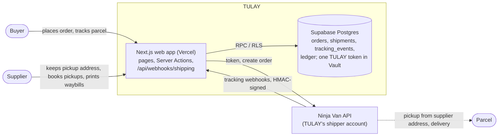
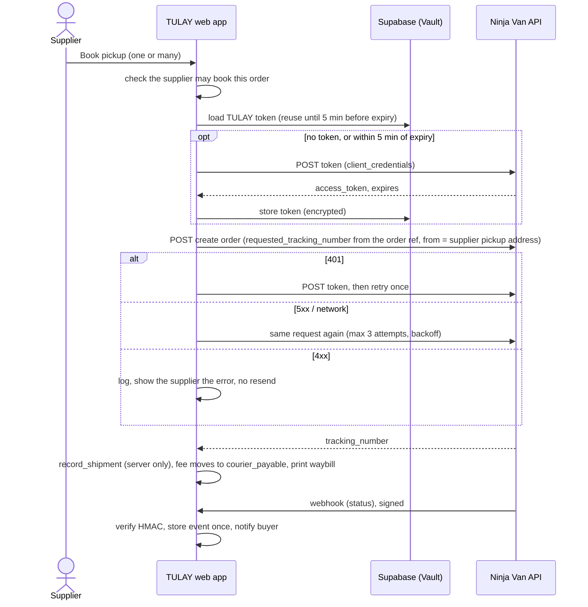

# TULAY × Ninja Van: Shipper Integration

TULAY ships every courier parcel on ONE Ninja Van shipper account that TULAY owns (owner decision, 2026-11-27). Suppliers do not connect accounts. TULAY uses the standard shipper API (OAuth API, Order API 4.2, Webhooks V2), not the plugin API. This file holds the facts and the two diagrams for Ninja Van. Diagrams are Mermaid; export them as PNG for the email.

| Item | Value |
| --- | --- |
| What it is | Philippine B2B marketplace. Suppliers sell; buyers order; TULAY books the courier parcel on its own Ninja Van account. |
| Account | One TULAY shipper account. Suppliers keep a pickup address (Company Profile, Ninja Van); Ninja Van picks up from it. |
| Own courier | A supplier may still ship on its own courier and type the tracking number in (manual shipment). TULAY does not book it. |
| API base | `NINJAVAN_API_BASE`, with the country code. Sandbox `https://api-sandbox.ninjavan.co/sg` (the docs say all sandbox requests go to `/sg`). Production `https://api.ninjavan.co/ph`. |
| Token | `POST {NINJAVAN_API_BASE}/2.0/oauth/access_token` with `client_id`, `client_secret`, `grant_type: "client_credentials"`. Answer: `access_token`, `expires` (epoch seconds), `expires_in`, `token_type`. Valid at least one hour. |
| Create order | `POST {NINJAVAN_API_BASE}/4.2/orders` |
| Credentials | Client ID and Client Key from Ninja Dashboard, Settings > IT Settings, after the account manager enables API access. The docs list a "Postpaid Pro" account as a prerequisite. |
| Env vars | `COURIER_PROVIDER=ninjavan`, `NINJAVAN_API_BASE`, `NINJAVAN_CLIENT_ID`, `NINJAVAN_CLIENT_SECRET`. `NINJAVAN_MOCK=1` is local only. |
| Webhook URL | `https://<staging-domain>/api/webhooks/shipping`. It must be public (not localhost) and registered for TULAY's account. How exactly: confirm with the account manager. |
| Webhook signature | Header `X-Ninjavan-Hmac-Sha256` = base64 HMAC-SHA256 of the raw body, keyed with the Client Key (`NINJAVAN_CLIENT_SECRET`). Webhooks V2 status names. TULAY answers 200 quickly; Ninja Van retries for up to 48 hours. |
| Shipping fee | The buyer pays it at checkout. When TULAY books the parcel (`record_shipment`, server only), the ledger moves the fee from the supplier's payable to `courier_payable` (owed to Ninja Van). Manual shipments leave it with the supplier. |
| COD | Off (`cod_max_order_centavos = 0`). On TULAY's account Ninja Van would pay the COD cash to TULAY, not the supplier. |
| Waybills | Printed by TULAY (QR + Code-128 of the tracking number), so no Waybill API calls. |

## C4 Level 2: containers

## API sequence

## Audit rules and where the code meets them

Ninja Van's own process for shippers: create at least three test orders in the sandbox through the integration (not Postman), then submit them via the audit link. Waybill access is a separate request; TULAY prints its own waybills, so only the Create Order audit applies.

| Ninja Van rule | Where |
| --- | --- |
| Store token + expiry; get a new token only within 5 min of expiry or after a 401 | `lib/shipping/ninjavan-auth.ts`; TULAY's one token in `private.platform_courier_tokens` + Vault (`courier_save_platform_token` / `courier_load_platform_token`, service role only) |
| Retry 5xx only; on 4xx log and don't resend | `lib/shipping/ninjavan-http.ts` |
| Same order never booked twice | `requested_tracking_number` from the order ref (`ninjavan-wire.ts`) + unique `shipments.order_id` |
| Push webhooks, no polling | `app/api/webhooks/shipping/route.ts` (signature, idempotent per event id, 200 for ignored statuses) |
| Own waybill with QR + Code-128 | `lib/shipping/waybill.ts`, `/ship/waybills` |
| One-click (bulk) order creation showing tracking numbers | Supplier Orders: "Book N Pickups" + Tracking column |
| One-click (bulk) waybills in a new tab | "Print N Waybills" after booking |
| Settings: sender address, preferences | Company Profile → Ninja Van card (pickup address only; credentials are TULAY's env vars) |
| Live status + customer notifications | order page tracking timeline; `record_tracking_event` notifies the buyer |

Ninja Van paths, fields and status names are in `lib/shipping/ninjavan-wire.ts`. They match the Ninja Van API docs and are still marked `TODO(ninjavan)` until checked against a live sandbox.

## Open questions for Ninja Van

1. Does an account that ships for many sellers need the "Marketplace" account type? Can one account schedule pickups from many different pickup addresses? (The docs say a new pickup address may update the account's pickup address.)
2. `requested_tracking_number` length: the schema says at least 9 characters, an error message says 1 to 9 with no prefix. TULAY sends 12 (for example `ORD202600012`).
3. After a "Duplicate Tracking ID" answer (error 109201), can the existing tracking number be read back?
4. How are webhooks subscribed for a shipper account? (The docs have a "Configure a webhook" section; we need the steps for TULAY's account.)
