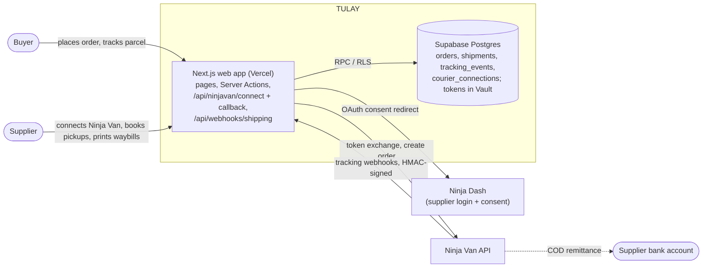
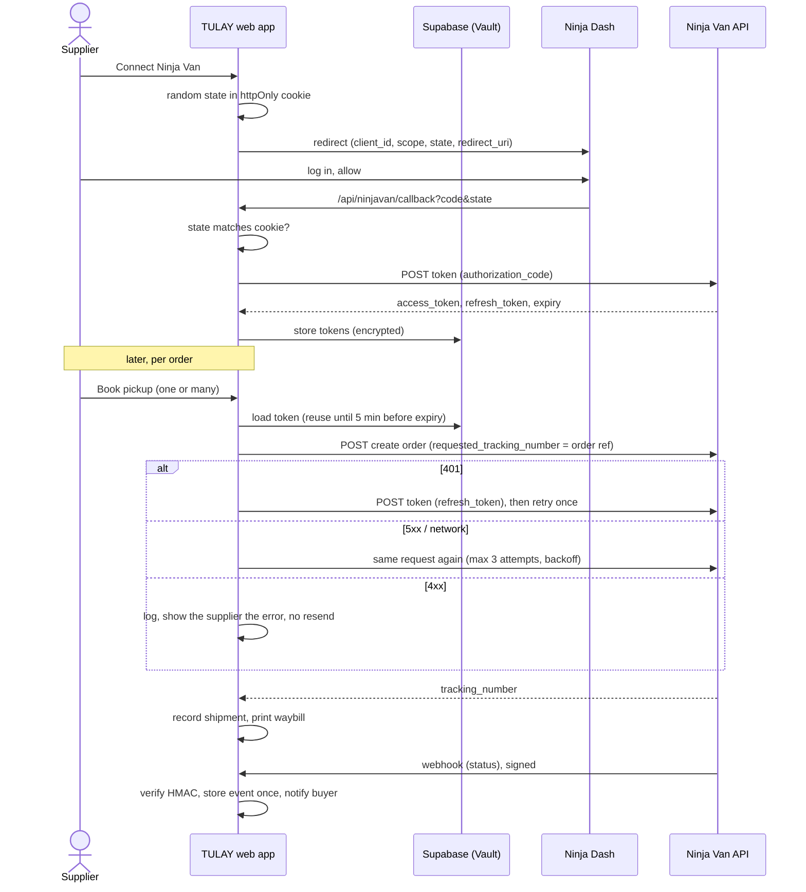

# TULAY × Ninja Van: Plugin Integration

What Ninja Van asks plugin partners to hand in: plugin name, sandbox redirect URI, scopes, a C4 Level-2 diagram and an API sequence diagram. This file holds all five. Diagrams are Mermaid; export them as PNG for the email.

| Item | Value |
| --- | --- |
| Plugin name | TULAY |
| What it is | Philippine B2B marketplace. Suppliers sell; buyers order; each supplier ships on its **own** Ninja Van account. |
| Sandbox redirect URI | `https://<staging-domain>/api/ninjavan/callback` (fill in at step 4) |
| Local redirect URI | `http://127.0.0.1:3000/api/ninjavan/callback` |
| Webhook URL | `https://<staging-domain>/api/webhooks/shipping` |
| Scopes | `NINJAVAN_SCOPES` env var. TODO(ninjavan): confirm the PH names for create order + tracking webhooks. |
| COD | Collected by Ninja Van and remitted to the supplier's own account. TULAY never holds the cash. |
| Waybills | Printed by TULAY (QR + Code-128 of the tracking number), so no Waybill API calls. |

## C4 Level 2: containers

## API sequence

## Audit rules and where the code meets them

| Ninja Van rule | Where |
| --- | --- |
| Store token + expiry; refresh only ≤ 5 min before expiry or after 401 | `lib/shipping/ninjavan-auth.ts`, tokens in `private.courier_tokens` + Vault |
| Retry 5xx only; on 4xx log and don't resend | `lib/shipping/ninjavan-http.ts` |
| Same order never booked twice | `requested_tracking_number` from the order ref (`ninjavan-wire.ts`) + unique `shipments.order_id` |
| Push webhooks, no polling | `app/api/webhooks/shipping/route.ts` (signature, idempotent per event id, 200 for ignored statuses) |
| Own waybill with QR + Code-128 | `lib/shipping/waybill.ts`, `/ship/waybills` |
| One-click (bulk) order creation showing tracking numbers | Supplier Orders: "Book N Pickups" + Tracking column |
| One-click (bulk) waybills in a new tab | "Print N Waybills" after booking |
| Settings: credentials, sender address, preferences | Company Profile → Ninja Van card |
| Live status + customer notifications | order page tracking timeline; `record_tracking_event` notifies the buyer |
| Suppliers subscribe to events in their dashboard | reminder on the Ninja Van card |

All Ninja Van paths, fields and status names are in `lib/shipping/ninjavan-wire.ts`, marked `TODO(ninjavan)` until checked against the PH docs.
